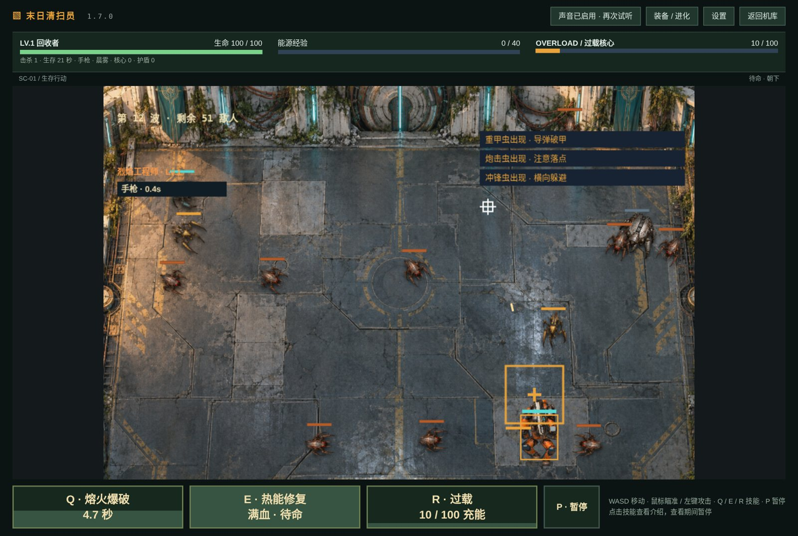
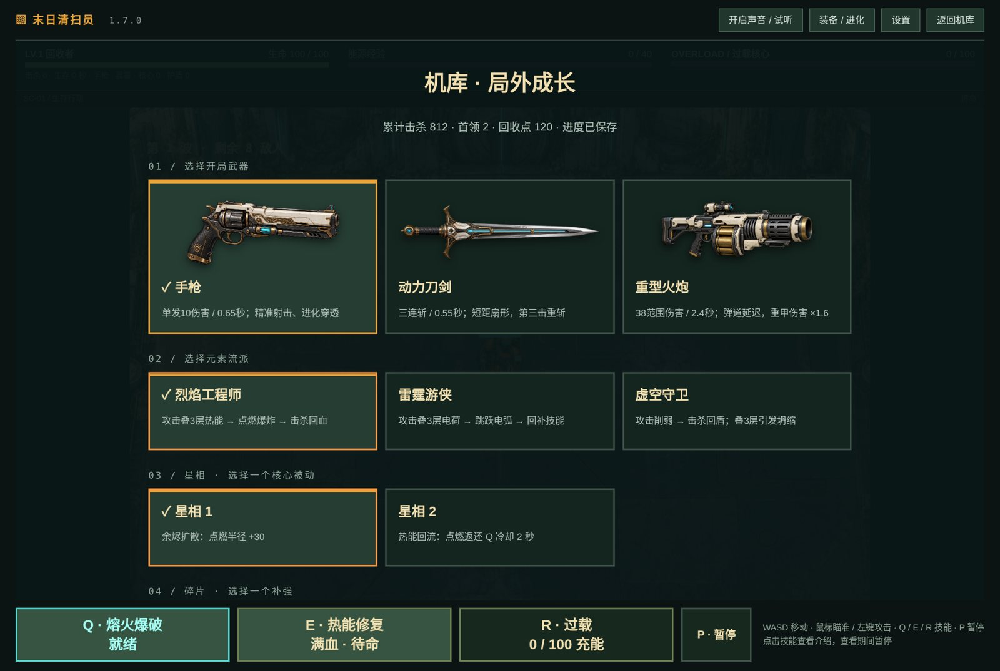
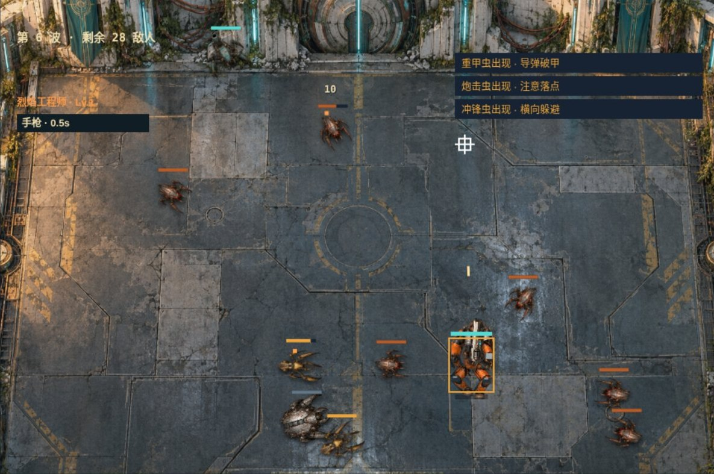
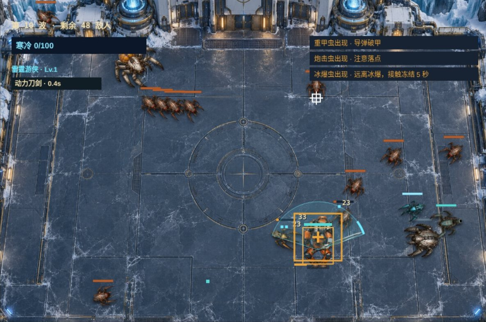
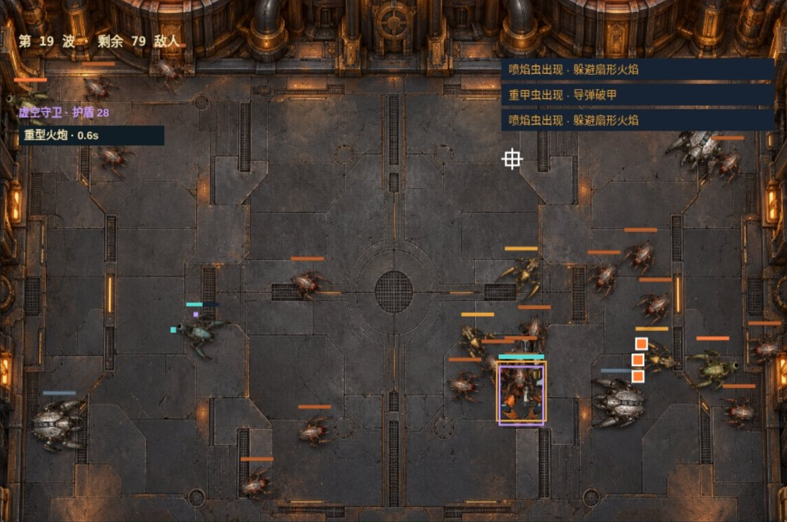

# 末日清扫员 ScrapRunner

> 俯视角割草射击 · JavaScript + Canvas 2D · Windows 便携版 v1.7.0

## ⬇ 下载试玩

**[点此下载 Windows 便携版（约 23 MB）](https://github.com/bailiyyds/ScrapRunner/releases/latest/download/ScrapRunner-1.7.0-Windows.zip)**

解压后双击 `ScrapRunner-1.7.0.exe`。需要已安装 Microsoft Edge 或 Google Chrome。程序未签名，Windows 可能提示“发布者未知”，选择“仍要运行”即可。

也可以不下载 EXE：把本仓库 `web/` 文件夹下载到本地，用 Chrome / Edge 打开 `web/index.html` 直接游玩。

## 玩法

旧历 2179 年，失控的机械虫群吞噬了城市。玩家作为回收者，在三张地图上抵挡 20 波虫潮，击败最终 Boss。

| 维度 | 内容 |
|---|---|
| 武器 | 手枪（可进化穿透）· 动力刀剑（三连斩）· 重型火炮（范围破甲） |
| 流派 | 烈焰工程师 · 雷霆游侠 · 虚空守卫，可搭配任意武器 |
| 技能 | Q 流派攻击 · E 流派辅助 · R 满能量过载 |
| 地图 | 废城回收场 · 极寒冰原（冻结）· 熔炉废墟（灼烧），各 20 波 |
| Boss | 预警跃击 → 二阶段机关 → 三阶段限时破盾 |

操作：WASD 移动 · 鼠标瞄准 · 按住左键攻击 · Q / E / R 技能 · P 暂停

| 废城回收场 | 极寒冰原 | 熔炉废墟 |
|---|---|---|
|  |  |  |

## 技术要点

- 16 个模块按职责拆分：主循环、战斗、敌人与波次、武器进化、流派构筑、局外成长、步态动画、光照天气等
- 刀剑扇形判定：计入敌人半径与边缘擦边，角度用 atan2(sin, cos) 归一化，每刀对同一敌人只结算一次，与帧率无关
- 步态按移动距离推进（每 96 像素一轮，12 帧连续插值），转向不重置脚步相位
- 贴图加载失败时自动退回代码绘制的轮廓，不会因资源缺失崩溃
- .NET 启动器把游戏和素材打包进单个 EXE

完整更新说明见 [使用说明.txt](使用说明.txt)。

---
作者：贺奕博 · 南通大学 · 3113541096@qq.com
